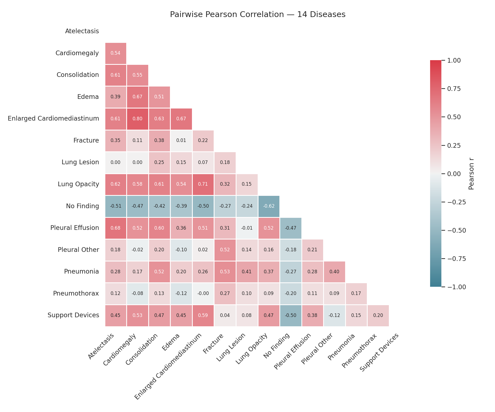

# XRay-ML: ConvNeXt with an Optional Label-Attention Head for Chest X-ray Diagnosis


## Overview

**XRay-ML** is a complete, reproducible deep-learning pipeline developed for the **Grand X-ray Slam (Division A)** Kaggle competition. The system performs **multi-label diagnosis of 14 thoracic diseases** from chest X-ray images using a **ConvNeXt-Tiny backbone**, with an optional **Label-Attention Head** designed to model disease co-occurrence.

The pipeline covers **data preprocessing, efficient storage, training, evaluation, exploratory data analysis (EDA), and submission generation**.

The project was a two-person Kaggle team entry. The code in this repository was implemented by Zain Soliman.

---

## Key Results

| Run | Setup | Mean AUROC (leaderboard) |
|---|---|---|
| Final competition submission | Earlier version of this pipeline, plain ConvNeXt head. The exact configuration was not preserved. | **0.9299** |
| Earlier version with label-attention head | Folds trained on all images, dropout applied to the logits | 0.9285 |
| **This repository's script** | Label-attention head, patient-wise held-out folds, 5-fold ensemble | 0.9283 |

* **Task**: Multi-label chest X-ray classification (14 diseases)
* **Backbone**: ConvNeXt-Tiny, 320×320 grayscale input
* **Competition standing** (0.9299 submission): top ~20% of ~192 teams. The winning score was 0.942.

**Note on results.** Differences of about 0.001-0.002 between runs are within noise for this setup. No controlled ablation of the attention head was kept, so this repository does **not** claim that the label-attention head helps or hurts performance. The configuration behind the 0.9299 submission could not be recovered, so this repository does not reproduce that exact run.

**Scope.** Experiments were limited to 320×320 inputs and ConvNeXt-Tiny because of free-tier Kaggle GPU limits. Higher input resolution and chest X-ray pretrained backbones were not tried and are the main next steps.

---

## Label Structure and Limitations

A label-attention head can only help where labels carry information about each other. The label statistics show two labels where that signal is weak: **Lung Lesion** and **Pneumothorax**.

**1. Weak inter-label correlation.** As shown in the Pearson correlation matrix (`disease_corr_matrix.png`, generated by `analyze_data.ipynb`), both labels show near-zero correlation with all other disease classes. Lung Lesion registers correlations of 0.00 with Atelectasis and Cardiomegaly, with no value exceeding 0.25 across the entire matrix. Pneumothorax is similarly isolated, with no correlation exceeding 0.27. For these labels, the attention head has little co-occurrence signal to use.



**2. Class imbalance.** Both labels are also among the rarest classes in the dataset:

| Label | Positive Samples |
|---|---|
| Lung Opacity | 48,626 |
| Atelectasis | 38,834 |
| Enlarged Cardiomediastinum | 37,856 |
| Support Devices | 37,661 |
| Cardiomegaly | 35,000 |
| Pleural Effusion | 34,242 |
| No Finding | 33,957 |
| Consolidation | 29,384 |
| Edema | 26,671 |
| Fracture | 14,984 |
| Pneumonia | 14,379 |
| **Lung Lesion** | **11,899** |
| **Pneumothorax** | **8,814** |
| Pleural Other | 7,061 |

By contrast, Pleural Other has the fewest positive samples but correlates with Fracture and Lung Opacity (r = 0.52 for both) and Pneumonia (r = 0.40), so a label-attention head has more to work with there.

Whether these label properties affected the final scores was not measured, because per-label results from the competition runs were not kept. Small, subtle findings such as lung lesions and pneumothorax are also the kind of labels that tend to benefit from higher input resolution, which was not tested.

**Other limitations**

* No controlled ablation between the label-attention head and the plain head was kept.
* The exact configuration of the best competition run (0.9299) was not preserved.
* Inputs were limited to 320×320, and no chest X-ray pretrained backbone was tried.
* Reported scores come from single competition runs and have not been repeated across seeds.

---

## Methodology

### Data Preprocessing

* Raw X-ray images are resized to 320×320 and converted to grayscale.
* Images are stored in **memory-mapped NumPy arrays (`.npy`)**, allowing training on large datasets (107,374 training images from 32,076 patients) with minimal RAM usage.
* This preprocessing strategy reduces training I/O overhead and **accelerates training by ~40%**.

### Model Architecture

* A **ConvNeXt-Tiny** backbone (via `timm`, ImageNet-pretrained) is used for feature extraction.
* The classification head is switchable with one flag (`USE_LABEL_ATTENTION`):
  * `False`: timm's default ConvNeXt classifier.
  * `True`: a **Label-Attention Head**. The feature map is pooled to one vector, projected to 128 dimensions, and combined with 14 learned label embeddings. Multi-head self-attention (4 heads) runs over these 15 tokens, and a shared linear layer produces one logit per label. Dropout is applied to the per-label features, not to the logits.
* If the pretrained weights fail to download, the script prints a warning and falls back to random initialization.

### Training Strategy

* **Patient-wise 5-fold splitting** (stratified on "No Finding") prevents leakage between train and validation folds. The script asserts that no patient appears in both.
* Optimizer: AdamW with **layer-wise learning rate decay (LLRD)**.
* Scheduler: warmup followed by cosine decay.
* **EMA** of weights, gradient clipping, and mixed-precision training (`torch.amp`).
* Loss: asymmetric loss by default (BCE and focal loss are also available).
* Augmentation is off by default (`AUG_WEAK = False`). Horizontal flips are disabled even when it is on, because flipping moves the heart position, which is a label cue.
* Early stopping on held-out mean AUROC.
* **Ensemble inference**: the logits of the fold models are averaged, then passed through a sigmoid to produce `submission.csv`.

### Evaluation Outputs

For every fold the script saves a JSON report (`Runs/`) with the configuration, seed, mean AUROC (image and patient level), per-label AUROC, and training history. Per-fold F1-optimal thresholds are saved as well, but they are not used for the submission.

---

## Repository Structure

```
xray-label-attention/
├─ preprocess_train_and_generate.ipynb   # preprocessing + training + submission
├─ analyze_data.ipynb                    # EDA and label correlation analysis
├─ disease_corr_matrix.png               # label correlation heatmap
├─ requirements.txt                      # dependencies
├─ README.md                             # documentation
├─ LICENSE                               # MIT license
├─ CITATION.cff                          # citation metadata
├─ .gitignore                            # ignored files
└─ Runs/                                 # checkpoints and reports (generated)
```

---

## File Descriptions

### `preprocess_train_and_generate.ipynb`

This notebook contains the full pipeline.

**Preprocessing**

* Validates dataset paths and CSV integrity
* Packs images into memory-mapped `.npy` arrays using multiprocessing
* Generates:
  * `images_train_320_c1_uint8.npy`
  * `labels_train.npy`
  * `index_train.csv`
  * corresponding test files

**Training & Inference**

* Custom PyTorch datasets for memmap access
* Patient-wise group splitting with held-out validation per fold
* ConvNeXt-Tiny with a switchable head (`USE_LABEL_ATTENTION`)
* EMA, gradient clipping, AMP, and checkpointing
* Per-fold reports with per-label AUROC
* Ensemble inference and generation of `submission_<attn|plain>.csv`

**Useful settings (top of the training cell)**

| Setting | Meaning |
|---|---|
| `USE_LABEL_ATTENTION` | `True` for the label-attention head, `False` for the plain head |
| `FOLDS_TO_RUN` | `None` runs all folds; `1` trains only fold 0 (quick experiments) |
| `EPOCHS`, `SEED`, `K_FOLDS` | Training length, random seed and number of folds |
| `AUG_WEAK` | Enables the optional augmentation (off by default) |

### `analyze_data.ipynb`

* Computes per-disease label counts
* Calculates the Pearson correlation matrix across labels
* Visualizes disease co-occurrence patterns
* Saves the correlation heatmap as `disease_corr_matrix.png`

---

## Reproducibility

* The random seed is fixed via `SEED`, and with a fixed seed fold 0 always has the same validation patients, so runs can be compared on the same split.
* Patient-wise splits eliminate data leakage.
* GPU training is not bit-for-bit deterministic. Expect score differences of about 0.001-0.002 between repeated runs.
* Every output file name carries the run name (`attn` or `plain`), so runs do not overwrite each other.

---

## Hardware Requirements

* **GPU recommended** (≥8 GB VRAM)
* Tested on Kaggle GPUs (T4 / P100 / A100)
* CPU-only execution is possible but significantly slower

---

## Installation

```bash
pip install -r requirements.txt
```

---

## Usage (Kaggle)

1. Create a new Kaggle Notebook
2. Attach the dataset: `grand-xray-slam-division-a`
3. Upload the repository files or copy the notebooks
4. Make sure paths point to `/kaggle/input/` and outputs go to `/kaggle/working/`
5. Enable GPU acceleration
6. Run the preprocessing cells of `preprocess_train_and_generate.ipynb`, then the training cell
7. Retrieve `submission_attn.csv` (or `submission_plain.csv`) from `/kaggle/working/`

---

## License

This project is licensed under the **MIT License**. See the `LICENSE` file for details.

---

## Citation

If you use this work for research or academic purposes, please cite:

```text
Zain Soliman. XRay-ML: ConvNeXt with an Optional Label-Attention Head for Chest X-ray Diagnosis, 2025.
```

---

## Acknowledgements

* Kaggle Grand X-ray Slam organizers
* PyTorch and timm communities
* ConvNeXt authors
